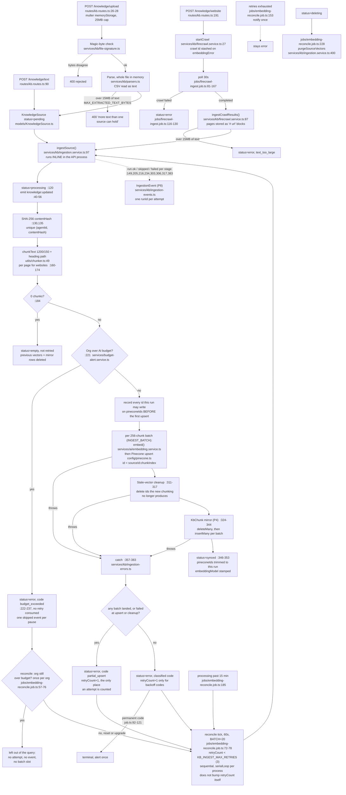
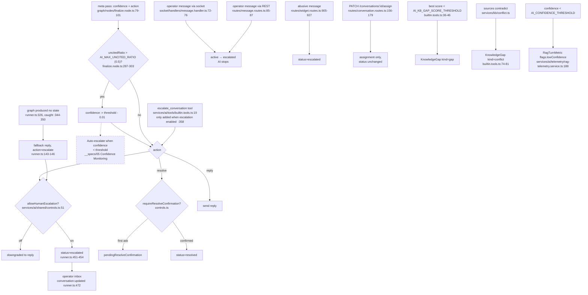
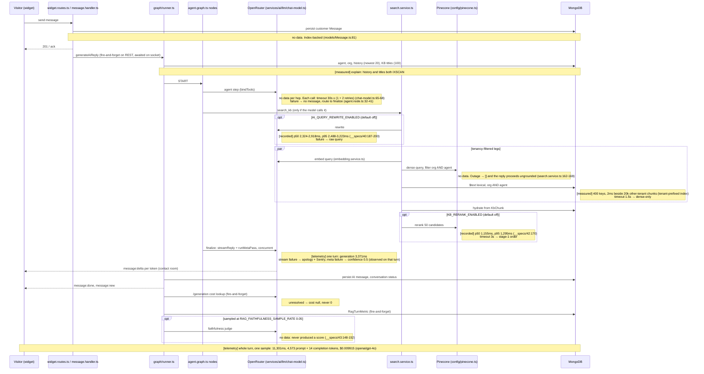

# End-to-End RAG Flow

How a visitor's message becomes a knowledge-grounded answer, as the code stands
on 2026-10-13 (every `file:line` re-checked against the tree that day).
Knowledge is keyed by **(organizationId, agentId)**: each agent
maps to one website and only ever sees its own knowledge base.

**Conventions.** Every box names the file that implements it (paths under
`apps/api/src/`). A **dashed border** marks something a spec under `__specs/`
documents that the code does not implement; each one is explained under its
diagram. Latencies are tagged the same way as `__specs/37-rag-pipeline-audit.md`:
**[telemetry]** (the development database, which holds **one** real turn),
**[recorded]** (measured by an earlier phase, cited to a spec line) and
**[measured]** (measured for the 2026-10-09 audit).

---

## 1. Ingestion

One pipeline. Uploads, pasted text, re-ingests, the reconcile job **and crawl
completion** all run `ingestSource()`. Until 2026-10-10 the first ingest of a
crawled website used a separate copy that skipped the mirror, stage events and
heading paths (`__specs/37` I2, fixed).

**Status transitions.** `pending → processing → {synced | empty | error}`, plus
`deleting`. `empty` is its own state and is not retried, for crawls too.

**Order matters in two places.** The budget gate runs **after** chunking and
before any provider spend (`services/kb/ingestion.service.ts:221`). The mirror
is written **after** the upsert so a failure leaves searchable vectors rather
than orphan rows; it is deleted and reinserted wholesale per source (`:324-344`).

**A budget pause waits, then resumes.** The gate records `budget_exceeded` and
one `skipped` stage event (`ingestion.service.ts:222-237`). Each reconcile tick
checks the budget once per paused org (`jobs/embedding-reconcile.job.ts:57-76`)
and leaves the sources of an org still over budget out of the retry query, so
they spend no attempt, write no event and take no slot in the 20-row batch. Once
the budget resets or the plan is upgraded, they take the ordinary retry path on
the next tick. Until 2026-10-13 the gate wrote no code, so the source read as
`unknown` and burned its attempts within minutes; and once it did carry the
code, every paused source wrote a "waiting" event each minute and held a batch
slot, so 20 paused sources stopped every other org's retries.

**One failed attempt counts once.** `ingestSource`'s catch increments
`retryCount` for backoff codes; the reconcile job only flips the source to
`pending` and calls it. With `KB_INGEST_MAX_RETRIES=3` a transient failure gets
the first run plus two retries. Until 2026-10-13 the job also incremented before
calling, so each failed retry spent two attempts and a source got one retry.

**Ticks cannot overlap inside one process.** All four loops are wrapped in
`serialLoop` (`jobs/serial-loop.ts`), which drops a tick whose predecessor is
still running. That guard is per-process, which is why the production compose
file pins the API at `replicas: 1` (`coolify/docker-compose.production.yml:50`):
a second replica would run a second reconcile loop over the same sources
(`__specs/38` S4, fixed 2026-10-10).

**Chunking is synchronous but linear** [measured]: 25MB of markdown chunks in
0.16s, CSV in 0.08s, HTML in 0.03s. It was quadratic until 2026-10-10 (537s for
a 24.9MB CSV; `__specs/37` I1, `__specs/38` S1). Peak memory for the largest
storable document is still above the 512MB container limit (`__specs/38` S5,
open).

## 2. Customer message flow

Two entry points reach the same runner: the widget REST route and the socket
handler.

```mermaid
flowchart TD
  W["Widget POST /conversations/:id/messages<br/>routes/widget.routes.ts:681"] --> SAVE
  S["socket message:send<br/>socket/handlers/message.handler.ts:10-105<br/>authorize: socket/authorize.ts"] --> SAVE
  SAVE["Persist customer Message<br/>models/Message.ts"] --> ACTIVE{"conversation.status<br/>== active?"}
  ACTIVE -->|no| NOAI["no AI reply"]
  ACTIVE -->|yes| RUN0
  RUN["generateAiReply<br/>services/ai/index.ts:23<br/>→ services/ai/graph/runner.ts:124"]

  RUN --> LOAD["Load agent, org, controls<br/>runner.ts:195-201"]
  RUN0["withTurnSlot<br/>services/ai/turn-gate.ts<br/>AI_MAX_CONCURRENT_TURNS=16, queue"] --> RUN
  LOAD --> HIST["History: NEWEST 20 before this turn<br/>graph/history.ts loadTurnHistory<br/>current message excluded"]
  HISTDOC["History: last 50 / ~6k tokens budget<br/>__specs/05 Context Window Management"] -.-> HIST
  HIST --> MSGS["buildInitialMessages runner.ts<br/>system + history + current<br/>operator rows as '[Human support agent]'"]
  MSGS --> START(["START  services/ai/graph/agent.graph.ts:60"])

  START --> RS{"routeFromStart<br/>agent.graph.ts:51-53<br/>presentToolResult?"}
  RS -->|"yes: form/OTP already ran<br/>(present-only shortcut)"| FIN
  RS -->|no| AG["agent node<br/>graph/nodes/agent.node.ts:12<br/>model.bindTools, toolTurns+1"]
  AG -->|"model call throws<br/>agent.node.ts:32-41"| AGF["return no message"]
  AGF --> RA

  AG --> RA{"routeFromAgent<br/>agent.graph.ts:24-38"}
  RA -->|no tool calls  :28| FIN
  RA -->|"halt  :29<br/>(unreachable: halt is only<br/>set in tools, which routes<br/>straight to finalize)"| FIN
  RA -->|"toolTurns >= maxToolTurns<br/>AI_MAX_TOOL_TURNS=10<br/>unanswered calls get notRun results in finalize"| FIN
  RA -->|tool calls| TL["tools node<br/>graph/nodes/tools.node.ts:56<br/>calls run SEQUENTIALLY  :73-150<br/>calls after a halt get notRun  :86-94<br/>input gate: tools/input-gate.ts"]

  TL --> RT{"routeFromTools<br/>agent.graph.ts:41-43"}
  RT -->|"halt latched<br/>state.ts:121-124"| FIN
  RT -->|else| AG

  FIN["finalize node<br/>graph/nodes/finalize.node.ts:177<br/>dangling calls answered  :146,213"] --> TWO["Promise.allSettled  :221-224<br/>• streamReply  :57  (customer prose)<br/>• runMetaPass  :79  (confidence, action, chips)"]
  TWO --> VAL["Context block + assertVerbatim  :186-192<br/>validateCitations  :268<br/>uncited-ratio signal  :287-303"]
  VAL --> CTRL["applyConversationControls<br/>runner.ts:355-361<br/>services/ai/shared/controls.ts"]
  CTRL --> PERSIST["Persist / promote AI Message  :380-394<br/>emit message:done  :398, message:new  :468-470"]
  PERSIST --> USG["recordConversationUsage<br/>runner.ts:412, fire-and-forget"]
  PERSIST --> TEL["recordRagTurn<br/>runner.ts:428<br/>services/ai/telemetry/rag-telemetry.service.ts"]
  USG -.->|resolved cost or null| TEL
  TEL -.->|sampled 5%| FAITH["online faithfulness judge<br/>services/ai/telemetry/online-faithfulness.service.ts:73"]

  style HISTDOC stroke-dasharray: 5 5
```

`HISTDOC` is dashed: `__specs/05` "Context Window Management" describes a
50-message / ~6k-token budget. The code replays a fixed **newest 20**
(`services/ai/graph/history.ts`). Until 2026-10-10 it returned the oldest 20 and
sent the current message twice (`__specs/37` G1, G2, fixed). The whole graph run
is bounded by `AI_TURN_DEADLINE_MS` (90s); past it the turn ends on the fallback
reply.

**The `halt` latch** is set by a tool that hands control to the customer (an
inline form or an OTP challenge) and latches on (`state.ts:121-124`). It ends the
loop **between** steps. Inside the **same** step, every call after the one that
set it is skipped and answered with a `notRun` tool result
(`tools.node.ts:86-94`), so a second tool asked for alongside a form never runs.
Until 2026-10-10 it did (`__specs/05` "ReAct conformance" §3e, `__specs/37` G4).

**The ceiling** is `AI_MAX_TOOL_TURNS` (10, `config/env.ts:79`), checked at
`agent.graph.ts:30`. The runner sets `recursionLimit = maxToolTurns * 2 + 10`
(`runner.ts:301`). When it fires, the last assistant message still carries
`tool_calls` with no results; `finalize` answers each one with a `notRun` tool
result before calling the model (`answerDanglingToolCalls`,
`finalize.node.ts:146-175`, applied at `:213`), because OpenAI-compatible APIs
reject an unanswered call. Until 2026-10-10 the transcript went out unchanged
and the turn ended on the fallback reply (`__specs/37` G4).

**Who may drive a turn.** `socket/authorize.ts` decides every
conversation-scoped socket event: an operator may act on any conversation in
their own organization, a contact only on their own session's conversations.
Covered by `socket-room-auth.test.ts` and `socket-message-auth.test.ts`.

## 3. Retrieval, expanded

The tenancy filter is drawn on every leg that touches stored knowledge.

```mermaid
flowchart TD
  Q["search_kb tool<br/>services/ai/tools/builtin.tools.ts"] --> US["understoodSearch<br/>services/ai/retrieval/understood-search.ts:50"]
  US --> RW{"AI_QUERY_REWRITE_ENABLED<br/>config/env.ts:94, default OFF"}
  RW -->|off| RAW["rawPlan: model's own query<br/>understood-search.ts:78"]
  RW -->|on| REW["rewrite + paraphrases (+HyDE)<br/>services/ai/retrieval/query-rewrite.ts<br/>timeout 4s  config/env.ts:99"]
  RAW --> RET
  REW --> RET

  RET["KbRetriever.searchHits per query<br/>services/ai/retrieval/kb-retriever.ts:103<br/>stage-1 K = 50 when rerank on  understood-search.ts:95"] --> SK["searchKb<br/>services/kb/search.service.ts:34"]
  SK --> GUARD{"agentId present?<br/>search.service.ts:56-61"}
  GUARD -->|no| REFUSE["REFUSED, returns []"]
  GUARD -->|yes| LEGS

  LEGS --> DENSE["Dense: embed query + Pinecone<br/>search.service.ts:131-170<br/>filter $and agentId $eq, organizationId $eq  :152-154"]
  LEGS --> LEX["Lexical: KbChunk $text<br/>services/kb/lexical-search.service.ts:24<br/>organizationId AND agentId  (guard :35-43)<br/>tenant-prefixed text index  models/KbChunk.ts:71-74<br/>timeout 1.5s  search.service.ts:69-82"]
  DENSE --> FLOOR["dense floor AI_KB_SEARCH_MIN_SCORE<br/>search.service.ts:90"]
  FLOOR --> HF["fuseHybrid alpha 0.7<br/>services/kb/hybrid-fusion.ts:53"]
  LEX --> HF
  LEX -.->|"timeout or error"| DONLY["dense-only<br/>search.service.ts:73-82"]
  DONLY --> HF
  HF --> HYD["hydrate from KbChunk mirror<br/>search.service.ts:197-245<br/>chunkId + organizationId filter<br/>hits with no live source dropped  :216-229"]

  HYD --> WIDEN{"0 hits AND rerank off?<br/>kb-retriever.ts:121"}
  WIDEN -->|yes| RETRY["searchKb again, minScore 0<br/>kb-retriever.ts:126"]
  WIDEN -->|no| VF
  RETRY --> VF

  VF["RRF across query variants<br/>services/ai/retrieval/fusion.ts:46<br/>(only when rewriting produced >1 query)"] --> FU{"follow-up round?<br/>understood-search.ts:113-127"}
  FU --> RR{"KB_RERANK_ENABLED<br/>config/env.ts:150, default OFF"}
  RR -->|on| RERANK["rerankHits<br/>services/ai/retrieval/rerank.ts:173<br/>floor on best candidate → noRelevantEvidence"]
  RR -->|off| CONF
  RERANK --> CONF{"KB_CONFLICT_DETECTION_ENABLED<br/>config/env.ts:180, default OFF"}
  CONF -->|on, top scores close| CHK["checkForConflict<br/>services/kb/conflict.ts<br/>priority, recency, score  :120-121"]
  CONF -->|off| GAP
  CHK --> GAP{"best score < AI_KB_GAP_SCORE_THRESHOLD?<br/>builtin.tools.ts:36-46"}
  GAP -->|yes| GAPW["KnowledgeGap upsert, kind=gap"]
  GAP --> CB["buildContextBlock  services/ai/context-block.ts:137<br/>dedupe, token budget 3000, numbered<br/>assertVerbatim  :193"]
  CB --> CITE["validateCitations<br/>services/ai/citation-validator.ts:87<br/>invalid markers stripped"]

  NS["Per-org Pinecone namespaces<br/>__specs/04, ingestion.service.ts:255-258 note"] -.-> DENSE
  style NS stroke-dasharray: 5 5
```

`NS` is dashed: per-org namespaces were once claimed as a control; isolation is
the AND-ed metadata filter plus the refusal (`services/kb/search.service.ts:56-61,152-154`).

Two things this diagram makes visible, both fixed on 2026-10-10:

- **Hydration drops hits whose source is gone.** A surviving vector for a
  deleted source, or for another organization, is filtered out and logged
  (`search.service.ts:216-229`). It used to be served titled "Untitled" with its
  stale Pinecone metadata text (`__specs/37` R4).
- **The lexical leg is tenant-scaled.** The text index is prefixed with
  `{organizationId, agentId}` (`models/KbChunk.ts:71-74`). A 200-chunk tenant
  next to 20,000 other chunks now examines 400 keys in 2ms [measured], where the
  unprefixed index examined 40,400 keys in 279ms and timed out at 100,000
  (`__specs/37` R1, `__specs/38` S3).

## 4. Escalation and handoff

`AUTOESC` is dashed: `__specs/05` "Confidence Monitoring & Auto-Escalation"
describes escalating every turn below the threshold. Nothing routes on
confidence; its only consumer is the telemetry flag (`rag-telemetry.service.ts:188`).
The uncited-ratio check is therefore a **signal, not a control**, and stays
open as A20 in `__specs/45-deferred-decisions.md`.

**Operator takeover** is the same on both paths: an operator reply over REST or
the socket flips an active conversation to `escalated`, which stops the AI, and
the socket path now also reaches the visitor's room (`__specs/37` D1, fixed
2026-10-10).

## 5. One turn, hop by hop

The brief for this diagram asked for measured p50 and p95 per hop from P9
telemetry. **The telemetry holds one turn**, so no percentile exists. Each hop is
annotated with what does exist: that one turn [telemetry], numbers earlier
phases recorded in specs [recorded], and measurements made for the 2026-10-09
audit [measured]. Missing values are marked "no data".

**What would replace "no data" with p50/p95:** real traffic. Each hop's
duration is already recorded per turn (`RagTurnMetric.retrieval.latencyMs`,
`generation.latencyMs`, `durationMs`, and per-search `rewriteLatencyMs` and
`rerank.latencyMs` in `state.ts:36-55`), and `GET /rag-metrics/summary` reports
p50/p95 once rows exist.

---

## Config

Per-agent `model` / `temperature` override the env defaults at call time
(`services/ai/graph/runner.ts`). `AI_CONFIDENCE_THRESHOLD` is telemetry and
dashboard only. Pinecone upserts batch at 100 and deletes at 1000
(`config/pinecone.ts:101-102`).

## Related

- [`__specs/37-rag-pipeline-audit.md`](__specs/37-rag-pipeline-audit.md): stage audit, failure modes, measured numbers
- [`__specs/38-scale-and-load-risks.md`](__specs/38-scale-and-load-risks.md): what breaks under load
- [`__specs/05-ai-agent-design.md`](__specs/05-ai-agent-design.md): graph design and ReAct conformance
- [`__specs/04-pinecone-firecrawl.md`](__specs/04-pinecone-firecrawl.md): vector store, crawl, index health
- [`__specs/39-rag-evaluation.md`](__specs/39-rag-evaluation.md): offline harness and online telemetry
- [`__specs/45-deferred-decisions.md`](__specs/45-deferred-decisions.md): parked decisions and every recorded assumption
